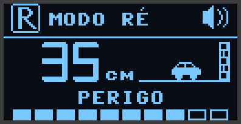

# Medidor de distância — Sensor de Ré (BitDogLab + VL53L0X)

Sensor de estacionamento feito com a placa **BitDogLab** (Raspberry Pi Pico W)
e um sensor de distância a laser **VL53L0X**. Mede a distância 20 vezes por
segundo e avisa com som, luzes e display — como o sensor de ré de um carro.
A tela também aparece no computador, por Bluetooth.

## Pastas

| Pasta | Conteúdo |
|---|---|
| [`sensor-de-re/`](sensor-de-re/) | programa MicroPython que vai para a placa — **leia o [README completo](sensor-de-re/README.md)** |
| [`pc/`](pc/) | `painel.html`: painel no computador por Bluetooth (Chrome ou Edge) |
| `.vscode/` | configuração do MicroPico (envia só a pasta `sensor-de-re/` para a placa) |

## Começo rápido

1. Grave o firmware MicroPython da Pico W na placa.
2. Abra esta pasta no VS Code com a extensão **MicroPico**.
3. **MicroPico → Upload Project to Pico** e reinicie a placa.
4. (Opcional) Abra `pc/painel.html` no Chrome ou Edge e clique em **Conectar**.

Os detalhes — ligação do sensor, controles, cada tela, calibração e
problemas comuns — estão em [`sensor-de-re/README.md`](sensor-de-re/README.md).
