# Sensor de Ré — BitDogLab + VL53L0X

Um **sensor de estacionamento** como o de um carro, feito com a placa
**BitDogLab** e um sensor de distância a **laser** (VL53L0X). Quanto mais perto
alguém ou alguma coisa chega, mais rápido o apito toca. As luzes mudam de
verde para vermelho, e o display mostra a distância em números grandes.

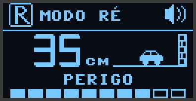

O projeto foi feito para uma demonstração no pátio da escola: um voluntário vai
andando em direção ao sensor e o apito acelera. Também serve para estudar
**MicroPython**, sensores, filtros e programação **sem travar o laço principal**.

**O que ele faz:**

- mede a distância **20 vezes por segundo**, até cerca de 2 m;
- tem **4 zonas** (LIVRE, ATENÇÃO, PERIGO e PARE). Em cada uma, o som, a cor
  e a tela mudam;
- o **apito acelera aos poucos**, conforme a distância diminui, e não só
  quando muda de zona;
- tem um **Modo Trena**, que mostra a distância em cm e em mm e permite
  congelar a medida;
- tem um **painel no computador por Bluetooth**: a mesma tela do OLED aparece
  no navegador, sem cabo.

---

## Sumário

1. [O que você precisa](#1-o-que-você-precisa)
2. [Arquivos do projeto](#2-arquivos-do-projeto)
3. [Gravar o firmware MicroPython](#3-gravar-o-firmware-micropython)
4. [Configurar o MicroPico no VS Code](#4-configurar-o-micropico-no-vs-code)
5. [Enviar o projeto para a placa](#5-enviar-o-projeto-para-a-placa)
6. [Pinos e ligação do sensor](#6-pinos-e-ligação-do-sensor)
7. [Controles](#7-controles)
8. [As telas: para que serve cada uma e como mexer](#8-as-telas-para-que-serve-cada-uma-e-como-mexer)
9. [Painel no computador (Bluetooth)](#9-painel-no-computador-bluetooth)
10. [Como calibrar as zonas](#10-como-calibrar-as-zonas)
11. [Problemas comuns](#11-problemas-comuns)
12. [Como funciona por dentro (para estudar)](#12-como-funciona-por-dentro-para-estudar)
13. [Créditos e licenças](#13-créditos-e-licenças)

---

## 1. O que você precisa

| Item | Observação |
|---|---|
| Placa **BitDogLab** com **Raspberry Pi Pico W** | Também funciona com Pico 2 W, desde que você use o firmware certo (veja a seção 3) |
| Sensor **VL53L0X** numa plaquinha adaptadora | GY-530, Pololu, Adafruit… Endereço I2C **0x29** |
| Cabo para o conector I2C da BitDogLab | 4 fios: GND, 3V3, SDA, SCL |
| Cabo USB | Para gravar e enviar o programa. Depois a placa pode funcionar na bateria |
| Computador com **VS Code** + extensão **MicroPico** | Para enviar os arquivos e ver as mensagens |
| *(opcional)* Google Chrome ou Microsoft Edge | Para o painel por Bluetooth |

---

## 2. Arquivos do projeto

```text
sensor-de-re/
├─ main.py            programa principal (laço não bloqueante)
├─ config.py          TODAS as configurações: pinos, zonas, som, brilho...
├─ cores.py           as cores da matriz e do LED, num só lugar
├─ lib/
│  ├─ vl53l0x.py      driver do sensor laser (porte da biblioteca da Pololu)
│  ├─ ssd1306.py      driver oficial do display OLED
│  ├─ display.py      telas: dígitos grandes, ícones, abertura
│  ├─ som.py          buzzer sem travar o programa
│  ├─ matriz.py       matriz 5x5 e LED RGB
│  ├─ filtros.py      mediana, zonas, suavização do número
│  ├─ controles.py    botões e joystick
│  └─ ble_painel.py   envia o estado por Bluetooth
├─ docs/telas/        imagens das telas (para este README)
└─ README.md

../pc/painel.html     painel do computador (fica FORA da pasta da placa)
```

> **Regra de ouro:** para mudar algum comportamento, procure primeiro no
> `config.py`. Os números ficam lá, com comentários que explicam o porquê
> de cada valor.

---

## 3. Gravar o firmware MicroPython

O firmware é o "sistema" que roda o Python na placa. Ele só precisa ser
gravado uma vez.

1. Descubra qual Pico está na sua BitDogLab. Está escrito na própria
   plaquinha: **Pico W** ou **Pico 2 W**.
2. Baixe o arquivo `.uf2` **oficial**:
   - Pico W: <https://micropython.org/download/RPI_PICO_W/>
   - Pico 2 W: <https://micropython.org/download/RPI_PICO2_W/>
3. Com a placa **desligada do USB**, segure o botão **BOOTSEL** da Pico e
   ligue o cabo USB. Só solte o botão depois de ligar.
4. Aparece um "pen drive" chamado **RPI-RP2** (ou **RP2350**). Arraste o
   `.uf2` para ele.
5. A placa reinicia sozinha, já com o MicroPython.

> **Como confirmar:** ao rodar o projeto, a primeira mensagem no terminal
> mostra a placa e a versão, por exemplo
> `Placa: Raspberry Pi Pico W with RP2040`. *RP2040* é a Pico W e *RP2350*
> é a Pico 2 W.

---

## 4. Configurar o MicroPico no VS Code

1. No VS Code, abra **Extensões** (Ctrl+Shift+X), procure **MicroPico** e
   instale.
2. Abra a pasta **`medidor_distancia_pico`** (a que contém `sensor-de-re/`)
   em **Arquivo → Abrir Pasta**.
3. A pasta já vem com um `.vscode/settings.json` configurado:

   | Configuração | Para que serve |
   |---|---|
   | `"micropico.syncFolder": "sensor-de-re"` | envia **só** a pasta do projeto para a placa |
   | `"micropico.autoConnect": false` | o MicroPico **não** se conecta sozinho, assim a porta USB fica livre para outras ferramentas |
   | `"micropico.pyIgnore": [..., "**/pc"]` | nunca envia a página do computador para a placa |

4. Para conectar, clique em **Pico Disconnected** na barra inferior do VS
   Code, ou use Ctrl+Shift+P → **MicroPico: Connect**.

> Os sublinhados vermelhos que aparecem no editor, em `machine`,
> `time.ticks_ms` e outros, **não são erros**. O VS Code está analisando o
> código como se fosse Python de computador, que não tem essas funções do
> MicroPython. A placa não liga para isso.

---

## 5. Enviar o projeto para a placa

1. **Se a placa já tinha outro projeto, faça uma cópia de segurança antes:**
   Ctrl+Shift+P → **MicroPico: Download Project from Pico**.
2. Ctrl+Shift+P → **MicroPico: Upload Project to Pico**. Também dá para
   clicar com o botão direito na pasta e escolher **MicroPico → Upload Project
   to Board**.
3. Pronto. O `main.py` roda **sozinho toda vez que a placa liga**, até na
   bateria.

Para ver as mensagens:

- abra o `main.py` e clique em **Run**, na barra inferior; ou
- desligue e ligue a placa com o MicroPico conectado.

> **Atenção:** o botão **Run** executa só o arquivo aberto. Ele **não** envia
> a pasta `lib/`. Por isso, sempre que mudar algo em `lib/`, faça de novo o
> **Upload Project**.

---

## 6. Pinos e ligação do sensor

### Pinos da BitDogLab usados no projeto

| Componente | Pinos | Observação |
|---|---|---|
| OLED SSD1306 128×64 | I2C1: SDA = **GP14**, SCL = **GP15** | endereço 0x3C |
| Matriz 5×5 WS2812 | **GP7** | ligada em zigue-zague (veja `lib/matriz.py`) |
| LED RGB | R = **GP13**, G = **GP11**, B = **GP12** | controlado por PWM |
| Botão A | **GP5** | pull-up interno: apertado = 0 |
| Botão B | **GP6** | pull-up interno |
| Buzzer | **GP21** | passivo, toca por PWM |
| Joystick | Y = **GP26** (ADC0), X = **GP27** (ADC1), botão = **GP22** | |
| Conector externo **I2C0** | SDA = **GP0**, SCL = **GP1** | |
| Conector externo **I2C1** | SDA = **GP2**, SCL = **GP3** | |

### Ligando o VL53L0X

| Pino da plaquinha do sensor | Ligar em |
|---|---|
| **VIN** (ou VCC) | 3V3 do conector |
| **GND** | GND do conector |
| **SDA** | SDA do conector |
| **SCL** | SCL do conector |
| XSHUT, GPIO1 | não usados (deixe sem ligar) |

Pode usar **qualquer um dos dois conectores I2C**, porque o programa procura o
sensor nos dois. Os nomes dos fios vêm impressos ao lado de cada conector da
placa.

> **Por que o conector I2C1 usa "SoftI2C"?** O conector I2C1 (GP2/GP3) usa o
> **mesmo periférico I2C1 do OLED** (GP14/GP15). Um periférico só funciona em
> um par de pinos por vez. Por isso, nesse conector, o programa faz o I2C
> "por software" (SoftI2C), e o OLED continua funcionando.

**Posição do sensor:** a face com o chip preto e duas **janelinhas** minúsculas
deve apontar **na horizontal**, para onde as pessoas vão chegar. Se houver
uma película protetora (amarela ou laranja) sobre o chip, retire.

---

## 7. Controles

| Controle | Modo Ré | Modo Trena |
|---|---|---|
| **Botão A** | liga/desliga o som | liga/desliga o "clique" dos botões |
| **Botão B** | vai para o Modo Trena | volta para o Modo Ré |
| **Joystick ↑↓** | ajusta o **limite da zona PARE** (10 a 40 cm) | — |
| **Clique do joystick** (apertar para dentro) | — | **congela/descongela** a medida |

Os botões fazem um "clique" curto de confirmação, mas só com o som ligado.

---

## 8. As telas: para que serve cada uma e como mexer

Cada tela abaixo traz duas partes: **como usar** e **como personalizar no
código**. Todas as imagens foram capturadas da placa de verdade.

### 8.1 Abertura

| Início | Meio | Fim |
|---|---|---|
| 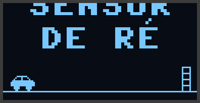 | 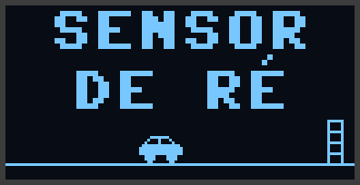 | 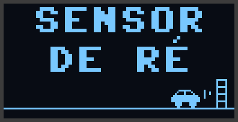 |

**Para que serve:** é a apresentação do projeto. O título desce e um
carrinho dá ré até a parede, "apitando" no final. Dura cerca de 2 s e
aparece toda vez que a placa liga.

**Como usar:** é só esperar. Os controles só funcionam depois que ela termina.

**Como personalizar** (em `lib/display.py`):

| O que mudar | Onde |
|---|---|
| texto do título | `_texto_ampliado("SENSOR", 2)` e `_texto_ampliado("DE RÉ", 2)` em `abertura()` |
| duração | `ABERTURA_QUADROS` (mais quadros = mais longa) e o `time.sleep_ms(700)` final |
| desenho do carro | `_ARTE_CARRO` (veja "Ícones" na seção 8.9) |

### 8.2 Sensor ausente

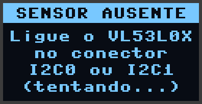

**Para que serve:** aparece quando o VL53L0X não responde em nenhum conector.

**Como usar:** ligue ou ajuste o cabo **com a placa funcionando**. O programa
tenta de novo a cada 2 s e segue sozinho quando encontra o sensor. Veja
também a seção [Problemas comuns](#11-problemas-comuns).

**Como personalizar:**

| O que mudar | Onde |
|---|---|
| texto | `esperar_sensor()` no `main.py` |
| intervalo entre tentativas | `INTERVALO_NOVO_SCAN_MS` no `main.py` |
| conectores pesquisados | `SENSOR_CONECTORES` no `config.py` |

### 8.3 Modo Ré (a tela principal)

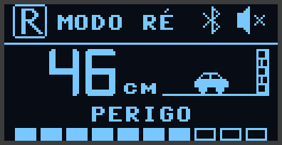

**Para que serve:** é o sensor de estacionamento. Cada parte da tela mostra
uma coisa:

| Parte da tela | O que mostra |
|---|---|
| **[R]** no canto esquerdo | modo atual, o "R" da marcha à ré |
| **MODO RÉ** | nome do modo |
| **Símbolo do Bluetooth** | aparece quando o computador está conectado |
| **Alto-falante** | som ligado 🔊 ou mudo 🔇 (com um X) |
| **Número grande** | distância em **cm**. Mostra `---` quando não há nada à frente |
| **Carrinho e parede** | o carro chega mais perto da parede conforme a distância diminui. A partir de 100 cm ele fica no início da cena |
| **Nome da zona** | LIVRE, ATENÇÃO, PERIGO ou PARE |
| **Barra de 10 segmentos** | proximidade: quanto mais cheia, mais perto |

As quatro zonas:

| LIVRE (> 100 cm) | ATENÇÃO (50–100 cm) | PERIGO (20–50 cm) | PARE (< 20 cm) |
|---|---|---|---|
| 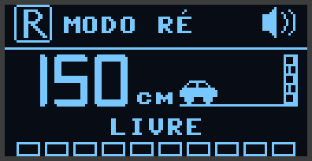 | 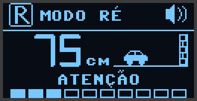 |  | 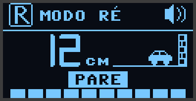 |
| verde, sem som | amarelo, bipe lento | laranja, bipe rápido | vermelho, **som contínuo**, matriz pisca, nome em destaque |

Sem nada à frente, o número vira `---`:

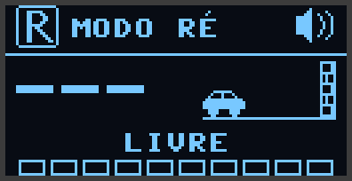

**Como usar:**

- aproxime um objeto ou uma pessoa: o número diminui, o carrinho anda e o
  bipe acelera;
- **A** silencia o som (o ícone ganha um X);
- **joystick ↑↓** ajusta onde começa o PARE (veja a seção 8.4);
- **B** troca para o Modo Trena.

**Como personalizar:**

| O que mudar | Onde |
|---|---|
| distâncias das zonas | `ZONA_ATENCAO_CM`, `ZONA_PERIGO_CM`, `ZONA_PARE_CM` no `config.py` (veja a seção 10) |
| estabilidade do número | `DISPLAY_SUAVIZACAO` e `DISPLAY_HISTERESE_CM` no `config.py`: mais suave = mais estável, porém mais lento |
| distância em que o carrinho começa a andar | `DISPLAY_CENA_CM` no `config.py` |
| quantos quadros por segundo | `DISPLAY_QUADRO_MS` no `config.py` (100 ms = até 10 quadros/s) |
| nomes das zonas na tela | `_NOME_EXIBIDO` em `lib/display.py` |
| posição de cada elemento | constantes do topo de `lib/display.py` (`Y_DIGITOS`, `Y_ZONA`, `Y_BARRA`, `CENA_X`...) |

### 8.4 Ajuste do limite PARE

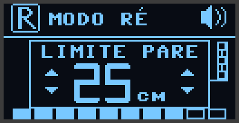

**Para que serve:** mudar, na hora, a distância em que o alarme vira **som
contínuo**. Por exemplo, para uma demonstração com pessoas, um limite maior
(30–40 cm) dá mais segurança.

**Como usar** (no Modo Ré):

- empurre o joystick **para cima** para aumentar ou **para baixo** para
  diminuir, de 1 em 1 cm;
- **segure** para repetir: quanto mais você empurra, mais rápido muda;
- os limites são **10 cm** e **40 cm**;
- a janela some **1,5 s** depois que você solta o joystick.

> O valor ajustado vale até a placa desligar. Ao ligar de novo, o limite volta
> para o `ZONA_PARE_CM` do `config.py`. Para mudar o valor de fábrica, edite
> o `config.py`.

**Como personalizar** (no `config.py`):

| O que mudar | Onde |
|---|---|
| faixa permitida | `ZONA_PARE_MIN_CM`, `ZONA_PARE_MAX_CM` |
| tamanho do passo | `AJUSTE_PASSO_CM` |
| tempo que a janela fica | `AJUSTE_MOSTRAR_MS` |
| velocidade da repetição | `JOY_REPETICAO_LENTA_MS`, `JOY_REPETICAO_RAPIDA_MS` |
| folga do centro do joystick | `JOY_ZONA_MORTA` |
| "para cima" diminuindo em vez de aumentar | troque `JOY_Y_INVERTIDO = True` |

### 8.5 Modo Trena

| Medindo | Congelada (❄) | Sem alvo |
|---|---|---|
| 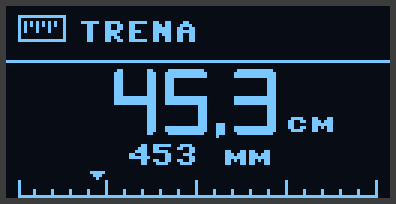 | 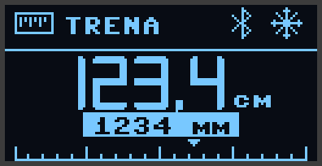 | 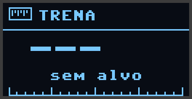 |

**Para que serve:** usar o sensor como uma **trena a laser**. Cada parte da
tela mostra uma coisa:

| Parte da tela | O que mostra |
|---|---|
| **Número grande** | distância em **cm, com uma casa decimal** |
| **Linha de baixo** | o mesmo valor em **mm** |
| **Régua** | de 0 a 200 cm, com traço maior a cada 50 cm. O **triângulo** aponta a medida |
| **Floco de neve ❄** | a medida está **congelada**, e o valor em mm aparece destacado |

**Como usar:**

1. aperte **B** para entrar no Modo Trena. O buzzer **não apita** neste modo;
2. aponte para o objeto e espere o número firmar, cerca de 2 s;
3. **clique o joystick** para **congelar**. Agora pode mover a placa e o
   valor fica na tela;
4. clique de novo para voltar a medir;
5. **B** volta ao Modo Ré.

**Como personalizar:**

| O que mudar | Onde |
|---|---|
| estabilidade do número | `TRENA_SUAVIZACAO` e `TRENA_HISTERESE_MM` no `config.py` |
| correção de erro fixo | `SENSOR_CORRECAO_MM` no `config.py` (veja a seção 10) |
| tamanho da régua | `TRENA_MAX_MM` em `lib/display.py` |

> **Limite do sensor:** abaixo de ~10 cm o VL53L0X mede **a mais**. Nos
> nossos testes, um objeto a 5 cm apareceu como ~9 cm. A trena funciona
> melhor entre 10 cm e 1,5 m, com objetos claros e retos (um livro ou uma
> caixa). Tela de celular e superfícies muito brilhantes refletem mal.

### 8.6 Tela "Parado"

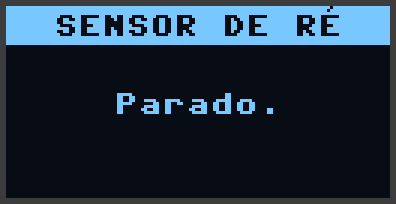

**Para que serve:** aparece quando o programa é interrompido (Ctrl+C no
terminal ou um erro). Ao parar, o programa **desliga o laser, o buzzer, a
matriz, o LED e o Bluetooth**, para nada ficar apitando ou aceso.

**Como usar:** para voltar a funcionar, desligue e ligue a placa ou clique em
**Run** no `main.py`.

### 8.7 Matriz 5×5 e LED RGB

Eles não são telas, mas fazem parte do painel.

**Para que servem:**

| Peça | O que mostra |
|---|---|
| **Matriz 5×5** | uma **barra de proximidade**: 1 linha acesa longe e as 5 bem perto. A barra sobe aos poucos, porque a última linha acende pela metade. A cor segue a zona (verde, amarelo, laranja, vermelho). Na zona **PARE**, **pisca** |
| **LED RGB** | a cor da zona atual |
| **Troca de cor** | é **suave**, em cerca de 150 ms. Nada pisca, a não ser o alerta do PARE |

**Como personalizar:**

| O que mudar | Onde |
|---|---|
| cores | `cores.py` (o mesmo valor serve para a matriz e para o LED) |
| brilho da matriz | `MATRIZ_BRILHO` no `config.py` (0.10 = 10 %, o máximo recomendado) |
| velocidade do pisca | `MATRIZ_PISCA_MS` no `config.py` |
| tempo da troca de cor | `COR_TRANSICAO_MS` no `config.py` |
| LED RGB com cor diferente da matriz | ajuste `LED_GANHO` (R, G, B) no `config.py` |

### 8.8 Som (buzzer)

| Zona | Som |
|---|---|
| LIVRE | silêncio |
| ATENÇÃO e PERIGO | bipes que **aceleram de forma contínua**: 1 bipe por segundo a 100 cm, chegando a ~7 por segundo no limite do PARE |
| PARE | som contínuo |

**Como personalizar** (no `config.py`):

| O que mudar | Onde |
|---|---|
| volume | `SOM_VOLUME_PCT` (5 = moderado, 50 = máximo e bem alto) |
| tom | `SOM_FREQ_HZ` |
| duração de cada bipe | `SOM_BIPE_MS` |
| ritmo mais lento e mais rápido | `SOM_INTERVALO_MAX_MS`, `SOM_INTERVALO_MIN_MS` |

### 8.9 Ícones: como desenhar os seus

Os ícones 16×16 ficam em `lib/display.py`, desenhados com texto: `#` é pixel
aceso e `.` é apagado. Por exemplo, o alto-falante:

```python
_ARTE_SOM_LIGADO = (
    "................",
    "......#.........",
    ".....##.....#...",
    "....###..#...#..",
    ".######...#...#.",
    ...
)
```

Edite os `#`, faça o **Upload Project** de novo e o ícone muda. Cada linha
precisa ter exatamente 16 caracteres, e são 16 linhas.

> Se mudar um ícone ou uma tela, mude também em `../pc/painel.html` (objeto
> `ARTE`). Assim a tela do computador continua idêntica à do OLED.

---

## 9. Painel no computador (Bluetooth)

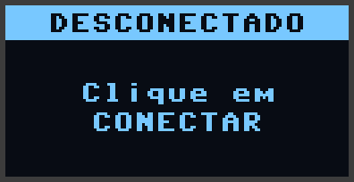

**Para que serve:** mostrar a tela do sensor **no computador ou num
projetor**, sem cabo. É bom para a plateia ver de longe. A Pico W tem
**Bluetooth embutido**.

**Como usar:**

1. Ligue a placa, que pode estar na bateria.
2. Abra o arquivo `pc/painel.html` (na pasta `medidor_distancia_pico`) no
   **Google Chrome** ou no **Microsoft Edge**. O Firefox não tem Web
   Bluetooth.
3. Clique em **Conectar** e escolha **SensorDeRe-XXXX**. O XXXX muda de placa
   para placa, assim dá para usar várias na mesma sala. Não precisa parear
   no Windows.
4. Depois de conectado, a página mostra:
   - a **tela do OLED** (com a mesma abertura, ícones e fonte);
   - a **matriz 5×5** e o **LED RGB**;
   - a distância, o limite do PARE, quantos pacotes por segundo chegam e
     quantos se perderam.

**Opções da página:**

| Parte da página | O que faz |
|---|---|
| **Display** | a tela do OLED, idêntica pixel a pixel |
| **Telemetria** | distância em números grandes, modo (Ré/Trena), zona, **régua das zonas** com um marcador que anda, limite PARE, pacotes por segundo e perdidos |
| **Distância nos últimos 30 s** | gráfico com as faixas das zonas ao fundo. Bom para mostrar a aproximação aos alunos |
| **Matriz 5×5 e LED RGB** | cópia das luzes da placa |
| **Conexão** | nome da placa, limite de parada, pacotes por segundo, perdidos e há quanto tempo chegou o último |
| **Preferências** | som no computador (bom para o projetor) e cor do display: azul, branco ou bicolor |
| **Simular** | um objeto de mentira se aproxima e se afasta. Funciona **sem a placa** e em qualquer navegador |
| **Modo apresentação** (botão no canto superior direito) | tela cheia só com o display e a telemetria em tamanho grande, para o **projetor no pátio**. **Esc** sai |
| **Reconexão** | se a conexão cair, a página tenta voltar sozinha |

Atalhos na URL (útil para deixar o projetor pronto):

- `painel.html?simular=1`: já abre simulando;
- `painel.html?apresentacao=1`: já abre no modo apresentação;
- `painel.html?apresentacao=1&simular=1`: as duas coisas.

A página funciona **sem internet**: não usa nenhuma fonte ou biblioteca
externa. O número da versão aparece no topo. Se depois de uma atualização a
página continuar igual, aperte **Ctrl+F5** para o navegador recarregar o
arquivo.

**Por que é rápido:** a placa **não envia a imagem da tela** (1024 bytes).
Ela envia só o **estado**: distância, zona, proximidade, mudo e modo, em
**11 bytes**. A página redesenha a tela com o **mesmo código** do OLED, que
foi traduzido para JavaScript, e o resultado é idêntico pixel a pixel. Nos
testes chegaram **21 pacotes por segundo**, sem nenhum perdido.

**Se o Chrome disser que o Bluetooth não está disponível** com o arquivo
aberto direto, sirva a página pelo computador:

```text
cd pc
python -m http.server
```

Depois abra <http://localhost:8000/painel.html>.

**Como personalizar** (no `config.py`):

| O que mudar | Onde |
|---|---|
| desligar o Bluetooth | `BLE_ATIVO = False` |
| nome anunciado | `BLE_NOME` |
| ritmo dos pacotes | `BLE_INTERVALO_MIN_MS`. Precisa ser **menor** que o intervalo entre leituras, ~48 ms |
| pacote de "estou vivo" quando nada muda | `BLE_REENVIO_MS` |

---

## 10. Como calibrar as zonas

### Mudar as distâncias das zonas

No `config.py`, em centímetros:

```python
ZONA_ATENCAO_CM = 100   # acima disso: LIVRE
ZONA_PERIGO_CM = 50     # entre 50 e 100: ATENÇÃO
ZONA_PARE_CM = 20       # entre 20 e 50: PERIGO; abaixo de 20: PARE
```

Passo a passo para ajustar no local da demonstração:

1. Marque no chão, com fita, as distâncias que você quer (por exemplo, 1 m,
   50 cm e 20 cm).
2. Peça para alguém parar em cada marca e veja a distância no display.
3. Ajuste os valores no `config.py` e faça o **Upload Project**.
4. Para mudar só o PARE durante a demonstração, use o **joystick** (seção
   8.4).

Regras para não confundir o programa:

- mantenha `ZONA_PARE_CM < ZONA_PERIGO_CM < ZONA_ATENCAO_CM`;
- mantenha `ZONA_PARE_MAX_CM` **menor** que `ZONA_PERIGO_CM`.

**Histerese** (`ZONA_HISTERESE_CM = 2`): para **sair** de uma zona ao se
afastar, o objeto precisa passar o limite com 2 cm de folga. Sem isso, uma
pessoa parada bem em cima dos 50 cm faria a cor e o som trocarem sem parar.
Para **entrar** numa zona mais perigosa, a troca é imediata.

### Conferir a exatidão do sensor (correção de distância)

1. Coloque um objeto **reto e claro** (um livro em pé) a **30 cm** da face do
   chip, medido com régua.
2. Entre no **Modo Trena**, espere o número firmar e anote. Repita a 50 cm e
   a 100 cm.
3. Se o erro for **sempre do mesmo lado e parecido** (por exemplo, +8, +10 e
   +9 mm), coloque o **contrário da média** no `config.py`:
   ```python
   SENSOR_CORRECAO_MM = -9
   ```
4. Se os erros forem muito diferentes entre si, o problema provavelmente é a
   medição com a régua ou o objeto inclinado, e não o sensor. Não use a
   correção nesse caso.

### Sensibilidade do sensor

`SENSOR_LIMITE_SINAL_MCPS = 0.10` é a força mínima do reflexo do laser para o
sensor aceitar uma medida. O padrão da ST é 0.25. **Medimos na placa:** uma
mão a 40 cm devolve só 0,19–0,26, e com 0.25 **47 %** das leituras eram
descartadas. Com 0.10, caíram para **3 %**, sem leituras falsas com a cena
vazia.

---

## 11. Problemas comuns

### "Sensor ausente" / o sensor não é encontrado

- Confira os 4 fios: **VIN→3V3, GND→GND, SDA→SDA, SCL→SCL**. SDA e SCL trocados
  é o erro mais comum.
- No terminal, o programa lista o que achou em cada conector:
  ```text
  Conector I2C0 (GP0/GP1): 0x6B
  Conector I2C1 (GP2/GP3): 0x29      <- o VL53L0X é o 0x29
  ```
  Se aparecer `nenhum` nos dois, é cabo ou alimentação.
- Se o sensor aparecer, mas der erro de ID ("ID do VL53L0X inesperado"), a
  plaquinha pode não ser um VL53L0X. O VL53L1X, por exemplo, é outro chip.

### As leituras ficam saltando ou "sumindo"

- **Alvo pequeno ou inclinado** (uma mão a 40 cm, por exemplo) reflete pouco.
  O filtro segura até 400 ms sem leitura boa (`FILTRO_TEMPO_SEM_ALVO_MS`)
  antes de dizer "sem alvo".
- **Superfícies pretas, brilhantes ou de vidro** (tela de celular) refletem
  mal. Teste com papel ou papelão.
- **Sol direto** no sensor atrapalha, porque o laser é infravermelho.
- **Muito perto** (menos de 10 cm): o VL53L0X mede a mais. Isso é uma
  limitação do chip.
- Para mais estabilidade, aumente `FILTRO_TAMANHO` para 7, um número
  **ímpar**. A resposta fica um pouco mais lenta.

### O buzzer está muito alto (ou baixo)

- Mude `SOM_VOLUME_PCT` no `config.py`. 5 é moderado, 2–3 é baixinho e 50 é o
  máximo.
- Na hora, use o **botão A** para silenciar.

### `ImportError` ou "can't import name" ao rodar

- A pasta `lib/` não foi enviada: faça **MicroPico → Upload Project to Pico**.
- Existe uma **cópia antiga** do módulo na **raiz** da placa (por exemplo,
  `/filtros.py`). O MicroPython procura primeiro na raiz, depois em `/lib`.
  Apague a cópia da raiz. A própria mensagem de erro lista os arquivos da
  placa para ajudar.

### O MicroPico não conecta / "porta em uso"

- Só um programa pode usar a porta USB (COM) de cada vez. Feche outros
  terminais e ferramentas (Thonny, `mpremote`…) e clique em **Connect** de
  novo.

### O OLED fica apagado

- O terminal mostra `Aviso: OLED nao encontrado em 0x3C`. Nesse caso, o
  sensor continua funcionando com som e luzes.
- Confira se a versão da sua BitDogLab usa GP14/GP15 para o OLED e ajuste
  `OLED_SDA`/`OLED_SCL` no `config.py`.

### As cores da matriz estão erradas ou a barra sai torta

- Confira `MATRIZ_PINO = 7`.
- Se a barra não subir de baixo para cima, a ordem do zigue-zague da sua
  placa é outra. Ajuste a função `indice()` em `lib/matriz.py`.

### O painel do computador não encontra a placa

- Use Chrome ou Edge e confirme que o **Bluetooth do computador está ligado**.
- Confira se `BLE_ATIVO = True` no `config.py`. O terminal mostra
  `Bluetooth: anunciando como SensorDeRe-XXXX`.
- Só um computador pode ficar conectado por vez. Feche a página em outros
  computadores.

---

## 12. Como funciona por dentro (para estudar)

### O laço principal não bloqueante

Um programa simples faria assim:

```python
buzzer.ligar(); time.sleep_ms(80); buzzer.desligar()   # NÃO fazemos isso!
```

Durante o `sleep`, a placa fica **parada**: não lê o sensor, não atualiza a
tela, não percebe os botões. Por isso, aqui **nada espera**. O laço dá
centenas de voltas por segundo, e em cada volta cada parte faz só um
pedacinho do trabalho:

```text
┌─> 1. o sensor tem medida nova?  -> filtro -> zona -> suavização
│   2. botões e joystick (só olham os pinos)
│   3. se algo mudou: decide o que cada saída deve mostrar ou tocar
│   4. som.atualizar()     liga/desliga o buzzer na hora certa (relógio)
│      matriz.atualizar()  redesenha no máximo a cada 30 ms
│      led.atualizar()     troca de cor suave
│      painel.atualizar()  envia 1/8 da tela por volta (~3 ms)
└───────┘
```

Cada `atualizar()` olha o relógio com `time.ticks_ms()`, decide o que fazer
**naquele instante** e retorna. **Medimos:** a volta mais lenta de cada
segundo fica tipicamente entre 5 e 20 ms (com picos raros de ~23 ms), mesmo
com som, luzes, tela e Bluetooth ao mesmo tempo, e o sensor mantém 20–21
leituras por segundo.

### Da leitura bruta até o alarme

```text
leitura bruta (mm)
   │  inválida (8190, >2 m)? vira "None" e não entra no filtro
   ▼
FiltroDistancia: mediana das últimas 5 + "retenção" de 400 ms
   ▼
Zonas: LIVRE / ATENÇÃO / PERIGO / PARE, com histerese
   ├─> proximidade (0 a 1, contínua) -> ritmo dos bipes, barra, matriz
   └─> SuavizadorExibicao -> número estável na tela (só a tela!)
```

- **Mediana, e não média:** um valor absurdo isolado (como 8191) puxaria a
  média, mas a mediana o ignora.
- **Retenção:** perder o alvo por um instante **não pode** desligar o alarme.
- **Histerese:** evita que a zona fique trocando em cima de um limite.
- **Suavização do número:** média móvel exponencial com histerese. Parado, o
  número muda menos de 1 vez a cada 2 s. O som e as cores **não** passam por
  ela e respondem na hora.

### Decisões tomadas com medidas na placa

| Problema encontrado | Medida | Solução |
|---|---|---|
| A mão a 40 cm "sumia" | 47 % de leituras inválidas, com sinal de 0,19–0,26 MCPS | limite de sinal de 0.25 para 0.10, com 3 % de inválidas |
| `oled.show()` travava o laço | 26 ms por tela | envio por páginas: 3,4 ms por volta |
| Desenhar a tela era lento | 6,7 ms por quadro | fundo pronto e dígitos em cache: ~4 ms |
| Matriz lenta | 5,5 ms por quadro | escrita direta no buffer: 2,7 ms |
| Número da tela pulando | 5 trocas/s parado | suavização: menos de 0,6 troca/s |
| Bluetooth com poucos pacotes | 5/s | intervalo mínimo de 50 para 40 ms: 21/s |

---

## 13. Créditos e licenças

- **`lib/vl53l0x.py`**: porte para MicroPython do driver da **Pololu**
  (*vl53l0x-arduino*, licença MIT), que por sua vez deriva da **API oficial
  da STMicroelectronics**. Também usa trechos do driver da **Adafruit**
  (*Adafruit_CircuitPython_VL53L0X*, Tony DiCola, MIT). O cabeçalho do
  arquivo traz os créditos e a licença completos.
- **`lib/ssd1306.py`**: driver **oficial** do *micropython-lib* (MIT), sem
  alterações.
- A **fonte 8×8** usada na página do computador foi extraída do próprio
  MicroPython (MIT).
- Os demais arquivos foram escritos para este projeto, para fins didáticos.
